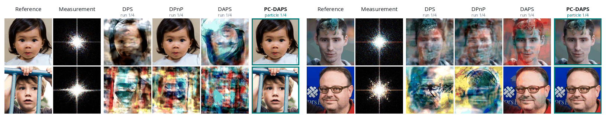

<h1 align="center">Beyond Best-of-k: Prior-Consistent DAPS for Ambiguous Nonlinear Inverse Problems</h1>

<p align="center">
  <a href="https://mervekocabas.github.io/PCDAPS/">[Project Page]</a>
  <a href="https://arxiv.org/abs/2610.31592">[Paper]</a>
</p>



PC-DAPS runs DAPS on a bag of particles per measurement, approximates the denoising posterior with a Gaussian mixture
built from the bag, and prunes particles that fit the measurement but not the prior (e.g. rotated or color-inverted
faces in phase retrieval) during sampling, without ground truth. One run gives K samples, reported as their mean
instead of the best-of-k runs.

## Setup

```bash
python3.10 -m venv pcdaps
source pcdaps/bin/activate
pip install torch==2.3.0 torchvision==0.18.0 --index-url https://download.pytorch.org/whl/cu121
pip install -r requirements.txt
sh download.sh    # FFHQ / ImageNet diffusion models, nonlinear-blur model, test sets
```

## Usage

Phase retrieval on the demo FFHQ images (200 annealing steps, bag of 4 particles):

```bash
python posterior_sample.py +data=demo-ffhq +model=ffhq256ddpm +task=phase_retrieval +sampler=edm_pcdaps \
    task_group=pixel save_dir=results num_runs=1 batch_size=10 save_traj=False name=pcdaps_demo_ffhq_pr gpu=0
```

Phase retrieval on the demo IMAGENET images (200 annealing steps, bag of 4 particles):

```bash
python posterior_sample.py +data=demo-imagenet +model=imagenet256ddpm +task=phase_retrieval +sampler=edm_pcdaps \
    task_group=pixel save_dir=results num_runs=1 batch_size=10 save_traj=False name=pcdaps_demo_imagenet_pr gpu=0
```

Each image gets K samples (`samples/{image}_run{run}_p{particle}.png`), and `eval.md` reports their mean.
`+sampler=edm_daps` runs the DAPS baseline.

To run all tasks on the first 100 test images (one task per GPU, 8 GPUs):

```bash
sh commands/pcdaps_ffhq.sh
sh commands/pcdaps_imagenet.sh
```

## Supported tasks

All tasks add Gaussian measurement noise with standard deviation 0.05.

- `phase_retrieval`: phase retrieval with oversampling ratio 2.0
- `down_sampling`: super-resolution (x4)
- `down_sampling_16x`: super-resolution (x16)
- `high_pass`: high-pass filtering, identity minus a Gaussian blur of kernel size 61 and intensity 5
- `inpainting`: 128x128 box inpainting
- `inpainting_rand`: 70% random inpainting
- `gaussian_blur`: Gaussian deblurring of kernel size 61 and intensity 3
- `motion_blur`: motion deblurring of kernel size 61 and intensity 0.5
- `nonlinear_blur`: nonlinear deblurring with the default setting of [bkse](https://github.com/VinAIResearch/blur-kernel-space-exploring)
- `hdr`: high dynamic range reconstruction of factor 2

`high_pass` follow Thaker et al., *Frequency-Guided Posterior Sampling for Diffusion-Based Image Restoration*.

## Toy examples

```bash
python toy/two_atom.py        # premature mode selection on a two-atom prior (Fig. 2)
python toy/gmm_langevin.py    # Langevin refinement under the Gaussian-mixture approximation (Fig. 4)
```

## Reproduction

If you would like to use our code base for comparisons, either to compare against PC-DAPS or baselines present in our paper, and run into issues reproducing numerical results present in the main paper or Appendix, we encourage you to open an issue so that we can assist you. We note that multiple algorithms in the repo (including DAPS and PC-DAPS) are sensitive to the PRNG and GPU used, and can result in significant differences in PSNR/SSIM/LPIPS. If your reproducibility issues are with PC-DAPS, we ask that you first reference similar discussions for DAPS, as most existing advice transfers:

- [DAPS/issues/16](https://github.com/zhangbingliang2019/DAPS/issues/16)
- [DAPS/issues/14](https://github.com/zhangbingliang2019/DAPS/issues/14)

## Acknowledgements

This codebase builds directly on prior open-source work [DAPS](https://github.com/zhangbingliang2019/DAPS) (Zhang et al., CVPR 2025).

## Citation

If you find this work useful in your research, please consider citing it:

```bib
@misc{kocabas2026pcdaps,
  title  = {Beyond Best-of-$k$: Prior-Consistent DAPS for Ambiguous Nonlinear Inverse Problems},
  author = {Kocabas, Merve and Burns, Benjamin A. and Geiger, Andreas and Gauen, Kent and Fridovich-Keil, Sara},
  year   = {2026},
  url    = {https://arxiv.org/abs/2610.31592}
}
```

